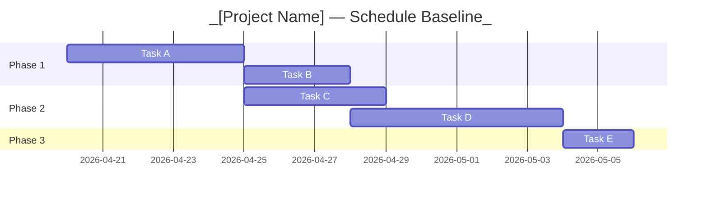

<!-- Generated by agentic-pm-kit:schedule-gantt on YYYY-MM-DD -->
<!-- Languages: communication=<value>, output=<value> -->
<!-- Source mode: offline | online -->

# Schedule Baseline — _[Project Name]_

---

## Schedule summary

| Field | Value |
|---|---|
| Project name | _[Project name]_ |
| Author | _[Name / role]_ |
| Version | _[e.g., 1.0]_ |
| Date produced | _[YYYY-MM-DD]_ |
| Schedule baseline date | _[YYYY-MM-DD — the date this baseline is approved]_ |
| Planned start | _[YYYY-MM-DD]_ |
| Planned end | _[YYYY-MM-DD]_ |
| Total duration | _[N weeks / N working days]_ |
| Critical path length | _[N working days]_ |

### Key milestones

| Milestone | Target date |
|---|---|
| _[Milestone name]_ | _[YYYY-MM-DD]_ |
| _[Milestone name]_ | _[YYYY-MM-DD]_ |
| _[Milestone name]_ | _[YYYY-MM-DD]_ |

---

## Mermaid Gantt diagram

_Replace the example tasks above with the actual project tasks, using the task IDs assigned in Step 2 of the facilitation script. Each row follows the format: `Task Name :id, YYYY-MM-DD or after <id>, Nd`._

---

## Task details

| Task ID | Task name | Start | End | Duration | Owner | Dependencies |
|---|---|---|---|---|---|---|
| _[t1]_ | _[Task name]_ | _[YYYY-MM-DD]_ | _[YYYY-MM-DD]_ | _[Nd]_ | _[Role]_ | _[None / after t0]_ |
| _[t2]_ | _[Task name]_ | _[YYYY-MM-DD]_ | _[YYYY-MM-DD]_ | _[Nd]_ | _[Role]_ | _[after t1]_ |
| _[t3]_ | _[Task name]_ | _[YYYY-MM-DD]_ | _[YYYY-MM-DD]_ | _[Nd]_ | _[Role]_ | _[after t1]_ |

---

## Critical path narrative

_Identify the tasks on the critical path (those whose delay directly extends the project end date). List them in order and explain why each is critical — typically because it has zero float or is the longest chain of dependent tasks. Example structure:_

The critical path runs through: **t1 → t2 → t4 → t5**, with a total duration of _[N]_ working days. Any delay to tasks on this path delays project completion by the same duration.

- **_[t1 — Task name]_**: _[Why it is critical]_
- **_[t2 — Task name]_**: _[Why it is critical]_
- **_[t4 — Task name]_**: _[Why it is critical]_

Non-critical tasks and their float: _[List tasks with available float and how many days of float each has]_

---

## Schedule assumptions and risks

### Assumptions

- _[e.g., All team members are available at the stated allocation percentages from start to finish.]_
- _[e.g., External dependencies (vendor deliverables, third-party APIs) are received by the dates noted above.]_
- _[e.g., Working days are Monday–Friday; public holidays in the project locale are excluded.]_

### Schedule risks

| Risk | Probability | Impact | Mitigation |
|---|---|---|---|
| _[e.g., Key resource unavailable]_ | _[H / M / L]_ | _[H / M / L]_ | _[e.g., Cross-train backup resource]_ |
| _[e.g., Requirement change mid-phase]_ | _[H / M / L]_ | _[H / M / L]_ | _[e.g., Freeze scope at Phase 2 gate]_ |

---

## Source consulted

**Canonical reference:** `https://en.wikipedia.org/wiki/Gantt_chart`
**Mode:** _[offline / online]_
**Note:** _If online mode: confirm the page was fetched and briefly describe what was read. If offline mode: confirm general knowledge of Gantt chart conventions and schedule-management principles was used. Do not fabricate quotations or page numbers._
