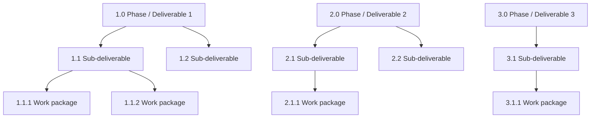

<!-- Generated by agentic-pm-kit:wbs on YYYY-MM-DD -->
<!-- Languages: communication=<value>, output=<value> -->
<!-- Source mode: offline | online -->

# Work Breakdown Structure

## Metadata

| Field | Value |
|---|---|
| Project name | _[Project name]_ |
| Author | _[Author name and role]_ |
| Version | _[e.g., 1.0]_ |
| Date | _[YYYY-MM-DD]_ |
| Source artifact | _[Path or version of the input epics-and-stories document]_ |

---

## Project summary

_[One paragraph describing the project scope this WBS covers, the number of top-level phases or deliverable areas, and the approximate total effort represented.]_

---

## Work breakdown

_[Three-level nested list. Level 1 = project phases or major deliverables. Level 2 = sub-deliverables. Level 3 = work packages (~40 hours or one sprint each). Use the numbering scheme shown below.]_

- **1.0 _[Phase or deliverable name]_**
  - 1.1 _[Sub-deliverable]_
    - 1.1.1 _[Work package]_
    - 1.1.2 _[Work package]_
  - 1.2 _[Sub-deliverable]_
    - 1.2.1 _[Work package]_
- **2.0 _[Phase or deliverable name]_**
  - 2.1 _[Sub-deliverable]_
    - 2.1.1 _[Work package]_
    - 2.1.2 _[Work package]_
  - 2.2 _[Sub-deliverable]_
    - 2.2.1 _[Work package]_
- **3.0 _[Phase or deliverable name]_**
  - 3.1 _[Sub-deliverable]_
    - 3.1.1 _[Work package]_

---

## Mermaid visualization

_[Graph showing Level 1 and Level 2 nodes plus a representative sample of Level 3 leaves. Illustrates hierarchy, not exhaustive scope.]_

---

## Work package details

| WBS code | Deliverable name | Owner | Duration (days) | Dependencies |
|---|---|---|---|---|
| 1.1.1 | _[Name]_ | _[Role or team]_ | _[N]_ | _[WBS codes, or "None"]_ |
| 1.1.2 | _[Name]_ | _[Role or team]_ | _[N]_ | _[WBS codes, or "None"]_ |
| 1.2.1 | _[Name]_ | _[Role or team]_ | _[N]_ | _[WBS codes, or "None"]_ |
| 2.1.1 | _[Name]_ | _[Role or team]_ | _[N]_ | _[WBS codes, or "None"]_ |
| 2.1.2 | _[Name]_ | _[Role or team]_ | _[N]_ | _[WBS codes, or "None"]_ |
| 2.2.1 | _[Name]_ | _[Role or team]_ | _[N]_ | _[WBS codes, or "None"]_ |
| 3.1.1 | _[Name]_ | _[Role or team]_ | _[N]_ | _[WBS codes, or "None"]_ |

---

## WBS dictionary

_[Short narrative (one to three sentences) per work package for the five to ten most critical or ambiguous packages. Defines exactly what is in scope for each package and what is excluded. Omit straightforward packages.]_

**1.1.1 — _[Work package name]_**
_[Scope narrative. What is included. What is explicitly excluded.]_

**1.1.2 — _[Work package name]_**
_[Scope narrative.]_

**2.1.1 — _[Work package name]_**
_[Scope narrative.]_

---

## Source consulted

**Canonical reference:** https://en.wikipedia.org/wiki/Work_breakdown_structure
**Mode:** _[offline / online]_
**Note:** _If online mode: confirm the page was fetched and briefly describe what was read. If offline mode: confirm general knowledge of PMBOK-aligned WBS practice was used. Do not fabricate quotations or page numbers._
