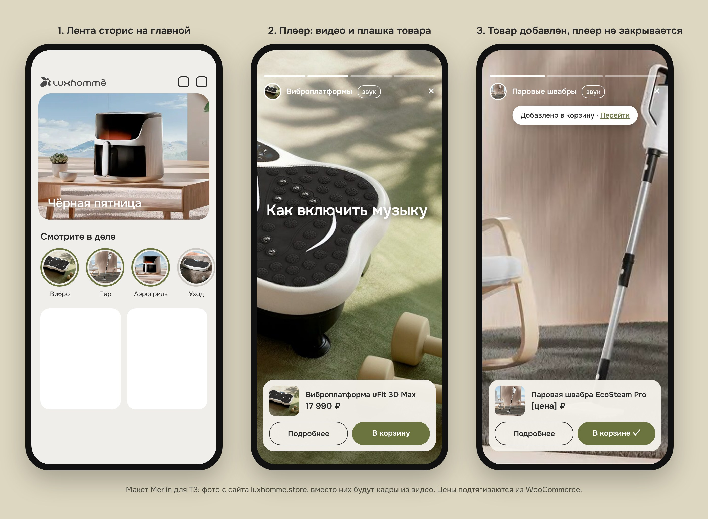
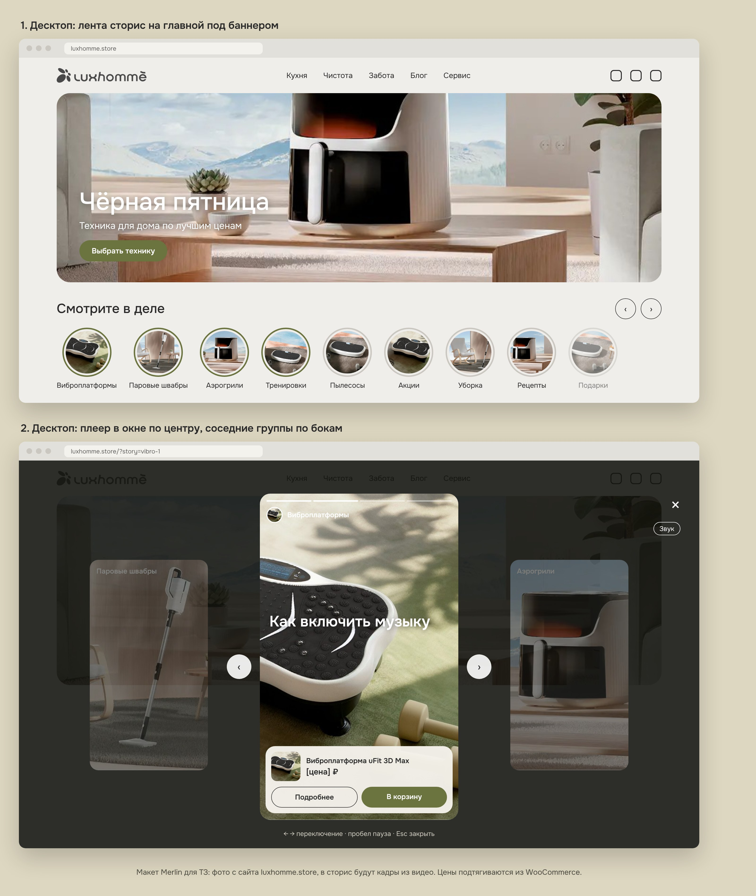

# Сторис на luxhomme.store: пакет для разработчика

Версия 23.11.2026. Подготовил Merlin.
Стек сайта: витрина Next.js, данные и каталог в WordPress + WooCommerce.

Состав пакета:
- этот файл (ТЗ, дизайн-токены, размеры, поведение, API, аналитика, приёмка);
- папка `img/` с макетами и примерами.

Внедрение на боевой сайт только после согласования с клиентом.

---

## 1. Что делаем

Лента коротких вертикальных видео о товарах (сторис). Из видео покупатель в один клик переходит в карточку товара или кладёт товар в корзину, не выходя из плеера.

| Макет | Файл |
|---|---|
| Телефон: лента на главной, плеер с плашкой товара, товар добавлен в корзину | `img/4_luxhomme_maket.jpg` |
| Компьютер: лента на главной под баннером, плеер в окне по центру | `img/5_luxhomme_maket_desktop.jpg` |
| Пример «Золотого Яблока»: лента под баннером | `img/1_goldapple_lenta-na-glavnoj.png` |
| Пример «Золотого Яблока»: плеер на компьютере | `img/2_goldapple_pleer.png` |
| Пример «Золотого Яблока»: товары из ролика | `img/3_goldapple_tovary-iz-storis.png` |





В макетах вместо кадров видео стоят фото с сайта, цена EcoSteam Pro и uFit 3D Max показана как «[цена]». На сайте цена и наличие приходят из WooCommerce.

---

## 2. Где показываем

| Страница | Что выводим | Место |
|---|---|---|
| Главная | Все активные группы сторис | Сразу под главным баннером |
| Категория каталога | Группы, у которых есть товары этой категории | Над сеткой товаров |
| Карточка товара | Группы, где привязан этот товар | Под галереей фото |

Если для страницы нет активных сторис, блок не выводится и не оставляет пустого места.

---

## 3. Дизайн-токены

Взяты с сайта luxhomme.store и использованы в макетах.

### Цвета

| Токен | Значение | Где |
|---|---|---|
| `--lx-ink` | `#2A2A2A` | Основной текст, обводка вторичной кнопки |
| `--lx-bg` | `#EFEEEB` | Фон страницы и блока ленты |
| `--lx-olive` | `#6B743F` | Обводка непросмотренных сторис, основная кнопка, ссылка в уведомлении |
| `--lx-olive-dark` | `#4F5630` | Акцентный текст на светлом фоне |
| `--lx-sand` | `#DDD7C1` | Второстепенные плашки |
| `--lx-seen` | `#C9C7C0` | Обводка просмотренных сторис |
| `--lx-plate` | `rgba(244, 242, 234, 0.97)` | Плашка товара в плеере |
| `--lx-white` | `#FFFFFF` | Текст поверх видео, уведомление «Добавлено в корзину» |
| `--lx-muted` | `#888888` | Старая (зачёркнутая) цена |
| `--lx-overlay` | `rgba(18, 19, 15, 0.88)` | Затемнение страницы под плеером на компьютере |
| `--lx-progress-off` | `rgba(255, 255, 255, 0.45)` | Непросмотренный сегмент прогресс-бара |
| `--lx-progress-on` | `#FFFFFF` | Просмотренный и текущий сегмент |

### Шрифт

- Onest (как на сайте), начертания 400, 500, 600.
- Запасной: `Arial, sans-serif`.

| Элемент | Размер, px | Начертание |
|---|---|---|
| Заголовок блока «Смотрите в деле», компьютер | 28 | 500 |
| Заголовок блока, телефон | 18 | 600 |
| Подпись под кружком, компьютер / телефон | 15 / 13 | 400 |
| Название группы в плеере | 15 | 600 |
| Название товара на плашке | 15 | 600, межстрочный 1.25 |
| Цена | 17 | 600 |
| Старая цена | 14 | 400, зачёркнутая |
| Кнопки на плашке | 15 | 600 |
| Уведомление «Добавлено в корзину» | 14 | 500 |
| Кнопка «Звук» | 13 | 500 |
| Подсказка по клавишам (компьютер) | 14 | 400 |

### Скругления и тени

| Элемент | Значение |
|---|---|
| Кружок сторис | `border-radius: 50%` |
| Плеер на компьютере | 22 px |
| Карточки соседних групп (компьютер) | 18 px |
| Плашка товара | 22 px (телефон), 20 px (компьютер) |
| Фото товара на плашке | 12 px |
| Кнопки | 30 px (форма «таблетки») |
| Уведомление | 20 px, тень `0 6px 20px rgba(0,0,0,0.2)` |

---

## 4. Лента сторис

| Параметр | Телефон (макет 390 px) | Компьютер (макет 1440 px) |
|---|---|---|
| Диаметр кружка | 76 px (допустимо 72–80) | 104 px (допустимо 96–110) |
| Обводка | 3 px, отступ картинки от обводки 3 px | 3 px, отступ 4 px |
| Расстояние между кружками | 14 px | 26 px |
| Отступ блока от краёв | 18 px | как у контейнера сайта (80 px в макете) |
| Подпись | под кружком, 6 px, до 14 символов | под кружком, 8 px |
| Листание | свайп пальцем, без стрелок | стрелки справа от заголовка: круг 44 px, обводка 1.5 px `--lx-ink` |
| Последний кружок | виден наполовину, если не помещается | виден наполовину, прозрачность 0.55 |

Состояния кружка:
- новая группа: обводка `--lx-olive`;
- просмотренная группа: обводка `--lx-seen`. Просмотр храним в `localStorage` (ключ `lx_stories_seen`, массив id групп), без авторизации. Если `localStorage` недоступен, все группы считаем новыми;
- фокус с клавиатуры: видимое кольцо фокуса 2 px `--lx-olive` с отступом 2 px.

Порядок: сначала непросмотренные, внутри по полю «Порядок» из админки.

---

## 5. Плеер

### Телефон

- Полный экран, видео 9:16, `object-fit: cover`, фон `#000`.
- Сверху прогресс-бар: по сегменту на каждый ролик группы, высота 3 px, зазор 4 px, скругление 2 px, отступ 14 px от краёв, сверху с учётом `env(safe-area-inset-top)` + 12 px.
- Под прогресс-баром строка: аватар группы 34 px (белая обводка 2 px), название группы, кнопка «Звук», крестик «Закрыть» 28 px справа.
- Жесты:
  - касание правой трети экрана: следующий ролик; левой трети: предыдущий;
  - удержание: пауза, отпустили: продолжение;
  - свайп вниз: закрыть;
  - свайп влево или вправо: соседняя группа.
- После последнего ролика группы открывается следующая группа, после последней плеер закрывается.

### Компьютер

- Модальное окно, фон страницы затемнён `--lx-overlay`.
- Плеер по центру, 9:16, высота около 85% окна (в макете 690 px при окне 820 px), скругление 22 px.
- Слева и справа карточки соседних групп: 250×445 px, скругление 18 px, прозрачность 0.4, название группы сверху слева. Клик по карточке открывает эту группу.
- Круглые кнопки ‹ › по бокам плеера: 52 px, фон `rgba(255,255,255,0.9)`.
- Крестик «Закрыть» 38 px и кнопка «Звук» в правом верхнем углу окна.
- Клавиши: ← → переключение роликов, пробел пауза, Esc закрыть. Подсказка по клавишам внизу окна, 14 px, цвет `#CFCBBE`.
- Фокус при открытии на плеере, при закрытии возвращается на кружок, с которого открыли.

### Общее

- Видео стартует без звука (`muted`, `autoplay`, `playsinline`). Кнопка «Звук» включает звук, выбор запоминается до конца визита (`sessionStorage`).
- Пока ролик грузится, показываем обложку (постер) и индикатор загрузки.
- Адрес при открытии: `?story=<id группы>-<номер ролика>`. «Назад» в браузере закрывает плеер, такой ссылкой можно поделиться, по ней плеер открывается сразу.
- При закрытии страница остаётся на той же позиции прокрутки.
- Текст поверх ролика (если вшит в видео) должен быть в безопасной зоне, см. раздел 8.

---

## 6. Плашка товара (главное)

Внизу каждого ролика. Телефон: отступы 12 px слева и справа, 26 px снизу. Компьютер: 12 px слева, справа и снизу внутри плеера.

| Элемент | Значение |
|---|---|
| Фон | `--lx-plate`, скругление 22 px, внутренний отступ 12 px, зазор между строками 12 px |
| Фото товара | 60×60 px (допустимо 56), скругление 12 px, `object-fit: cover` |
| Название | 15 px / 600, до 2 строк, дальше многоточие |
| Цена | 17 px / 600; старая цена рядом, 14 px, `--lx-muted`, зачёркнутая, отступ 6 px |
| Кнопки | в одну строку, равной ширины, зазор 8 px, высота около 44 px (padding 12 px 0) |
| «Подробнее» | прозрачная, обводка 1.5 px `--lx-ink`, текст `--lx-ink` |
| «В корзину» | фон `--lx-olive`, текст белый |

Логика:
- Клик по плашке или «Подробнее»: переход в карточку товара в той же вкладке, плеер закрывается. К ссылке добавляем `utm_source=site&utm_medium=stories&utm_campaign=<id группы>&utm_content=<id ролика>`.
- «В корзину»: только если товар в наличии и без вариаций. Добавление через API корзины WooCommerce без перехода. После добавления:
  - кнопка меняется на «В корзине ✓»;
  - сверху всплывает уведомление «Добавлено в корзину · Перейти» (белое, 14 px, ссылка `--lx-olive` с подчёркиванием, исчезает через 3 секунды);
  - счётчик корзины в шапке обновляется.
- Товар не в наличии: вместо «В корзину» серый текст «Нет в наличии», остаётся «Подробнее».
- Товар с вариациями (цвет, комплект): вместо «В корзину» кнопка «Выбрать» ведёт в карточку.
- Несколько товаров (до 3): плашки листаются горизонтально, видна часть следующей.
- Цена и наличие запрашиваются при показе ролика, руками в сторис не вписываются.

---

## 7. Админка WordPress

Тип записи «Сторис» (Custom Post Type `lx_story_group`), поля, например, через ACF:

| Поле | Ключ | Тип | Обязательное |
|---|---|---|---|
| Название группы | `title` | текст, до 14 символов для подписи | да |
| Превью группы | `cover` | изображение, квадрат от 300×300 | да |
| Ролики | `items` | повторитель, 1–10 строк | да |
| Ролик: видео | `items[].video` | файл MP4 | да |
| Ролик: обложка | `items[].poster` | изображение 1080×1920; если пусто, первый кадр | нет |
| Ролик: товары | `items[].products` | связь с товарами WooCommerce, 1–3, поиск по названию и артикулу | да |
| Ролик: текст кнопки | `items[].cta` | текст, по умолчанию «Подробнее» | нет |
| Где показывать | `places` | галочки: главная, категории, карточки | да |
| Порядок | `menu_order` | число | нет |
| Показ с / по | `date_from`, `date_to` | даты, можно пусто | нет |
| Статус | `status` | опубликовано / черновик | да |

В категориях и карточках сторис подбираются автоматически по привязанным товарам.

---

## 8. Требования к видео

- MP4, H.264 + AAC, вертикальное 9:16, 1080×1920.
- Длительность ролика 5–30 секунд, вес до 8 МБ.
- Для телефонов облегчённая версия 720×1280. Если сервер не умеет перекодировать, сжатие делаем до загрузки, в админке подсказка о лимите.
- Безопасные зоны для текста на видео: не ближе 250 px к верху (прогресс-бар, шапка) и 400 px к низу (плашка товара), считая по кадру 1080×1920.
- Субтитры желательно вшивать: смотрят в основном без звука.

---

## 9. API

REST-эндпоинт WordPress, ответ кэшируется на витрине 5–10 минут:

```
GET /wp-json/luxhomme/v1/stories?place=home
GET /wp-json/luxhomme/v1/stories?place=category&id=<id категории>
GET /wp-json/luxhomme/v1/stories?place=product&id=<id товара>
```

Пример ответа:

```json
{
  "groups": [
    {
      "id": "vibro",
      "title": "Виброплатформы",
      "cover": "https://luxhomme.store/wp-content/uploads/stories/vibro-cover.jpg",
      "order": 1,
      "items": [
        {
          "id": "vibro-1",
          "video": "https://cdn.luxhomme.store/stories/vibro-1.mp4",
          "video_mobile": "https://cdn.luxhomme.store/stories/vibro-1-720.mp4",
          "poster": "https://luxhomme.store/wp-content/uploads/stories/vibro-1.jpg",
          "duration": 14,
          "cta": "Подробнее",
          "products": [
            {
              "id": 123,
              "sku": "VIPLATB",
              "name": "Виброплатформа uFit 2D Standard",
              "url": "https://luxhomme.store/products/ufit-2d",
              "image": "https://luxhomme.store/wp-content/uploads/...jpg",
              "price": 4813,
              "regular_price": 5990,
              "in_stock": true,
              "has_variations": false
            }
          ]
        }
      ]
    }
  ]
}
```

Значения в примере (id, адреса, цены) условные. Цены в ответе берутся из WooCommerce в момент запроса.

Видео отдаём с CDN или отдельного домена статики, с поддержкой Range-запросов.

---

## 10. Производительность

- Блок ленты рендерится на сервере (SSR), картинки превью с `loading="lazy"` и размерами под кружок (не больше 2× диаметра).
- Видео не загружается, пока плеер закрыт. Открытый ролик грузится сразу, следующий заранее, остальные нет.
- Скрипт плеера подгружается отдельно (динамический импорт) по первому клику на кружок.
- PageSpeed главной на мобильном после внедрения падает не больше чем на 3 пункта.
- Поддержка: последние 2 версии Chrome, Safari (включая iOS), Яндекс Браузера, Firefox.

---

## 11. SEO и доступность

- Параметр `?story=` не создаёт новых страниц для индексации: в `robots.txt` директива `Clean-param: story`, на странице прежний canonical.
- Все кнопки с подписями `aria-label` («Следующая сторис», «Закрыть», «Включить звук»).
- Плеер в модальном окне: `role="dialog"`, `aria-modal="true"`, фокус внутри окна.
- Кружки ленты: кнопки с подписью группы, доступны с клавиатуры.

---

## 12. Аналитика (Яндекс Метрика)

JavaScript-цели, номер счётчика взять из текущей установки Метрики на сайте:

```js
ym(COUNTER_ID, 'reachGoal', 'stories_open', { group: 'vibro', page: 'home' });
ym(COUNTER_ID, 'reachGoal', 'stories_view_complete', { group: 'vibro', item: 'vibro-1' });
ym(COUNTER_ID, 'reachGoal', 'stories_product_click', { group: 'vibro', item: 'vibro-1', sku: 'VIPLATB' });
ym(COUNTER_ID, 'reachGoal', 'stories_add_to_cart', { group: 'vibro', item: 'vibro-1', sku: 'VIPLATB' });
```

| Цель | Когда |
|---|---|
| `stories_open` | Открыли плеер |
| `stories_view_complete` | Ролик досмотрен до конца |
| `stories_product_click` | Клик по плашке или «Подробнее» |
| `stories_add_to_cart` | Товар добавлен в корзину из плеера |

Цели создать в интерфейсе Метрики с теми же идентификаторами.

---

## 13. Справочный CSS из макетов

Это CSS, на котором собраны макеты. Он для ориентира по размерам и цветам, а не готовый код компонента.

```css
:root{
  --lx-ink:#2A2A2A; --lx-bg:#EFEEEB; --lx-olive:#6B743F; --lx-olive-dark:#4F5630;
  --lx-sand:#DDD7C1; --lx-seen:#C9C7C0; --lx-plate:rgba(244,242,234,.97);
  --lx-muted:#888; --lx-overlay:rgba(18,19,15,.88);
}
body{font-family:Onest,Arial,sans-serif;color:var(--lx-ink);background:var(--lx-bg)}

/* Лента */
.lx-stories__title{font-size:28px;font-weight:500}              /* телефон: 18px / 600 */
.lx-stories__strip{display:flex;gap:26px;overflow-x:auto}        /* телефон: gap 14px */
.lx-story{display:flex;flex-direction:column;align-items:center;gap:8px;flex:0 0 auto}
.lx-story__ring{width:104px;height:104px;border-radius:50%;padding:4px;border:3px solid var(--lx-olive)} /* телефон: 76px, padding 3px */
.lx-story__ring--seen{border-color:var(--lx-seen)}
.lx-story__ring img{width:100%;height:100%;border-radius:50%;object-fit:cover}
.lx-story__label{font-size:15px}                                 /* телефон: 13px */
.lx-stories__arrow{width:44px;height:44px;border-radius:50%;border:1.5px solid var(--lx-ink)}

/* Плеер */
.lx-player__progress{position:absolute;top:14px;left:14px;right:14px;display:flex;gap:4px}
.lx-player__progress i{flex:1;height:3px;border-radius:2px;background:rgba(255,255,255,.45)}
.lx-player__progress i.is-done{background:#fff}
.lx-player__head{display:flex;align-items:center;gap:10px;color:#fff;font-size:15px;font-weight:600}
.lx-player__avatar{width:34px;height:34px;border-radius:50%;object-fit:cover;border:2px solid #fff}
.lx-player__sound{font-size:13px;font-weight:500;border:1.5px solid #fff;border-radius:12px;padding:3px 8px}

/* Компьютер */
.lx-modal{position:fixed;inset:0;background:var(--lx-overlay)}
.lx-modal__player{height:85vh;aspect-ratio:9/16;border-radius:22px;overflow:hidden}
.lx-modal__side{width:250px;height:445px;border-radius:18px;opacity:.4}
.lx-modal__nav{width:52px;height:52px;border-radius:50%;background:rgba(255,255,255,.9)}
.lx-modal__hint{font-size:14px;color:#CFCBBE}

/* Плашка товара */
.lx-product{position:absolute;left:12px;right:12px;bottom:26px;background:var(--lx-plate);
  border-radius:22px;padding:12px;display:flex;flex-direction:column;gap:12px}
.lx-product__row{display:flex;gap:12px;align-items:center}
.lx-product__img{width:60px;height:60px;border-radius:12px;object-fit:cover}
.lx-product__name{font-size:15px;font-weight:600;line-height:1.25}
.lx-product__price{font-size:17px;font-weight:600}
.lx-product__old{font-size:14px;font-weight:400;color:var(--lx-muted);text-decoration:line-through;margin-left:6px}
.lx-product__btns{display:flex;gap:8px}
.lx-btn{flex:1;text-align:center;border-radius:30px;padding:12px 0;font-size:15px;font-weight:600}
.lx-btn--primary{background:var(--lx-olive);color:#fff}
.lx-btn--secondary{border:1.5px solid var(--lx-ink);color:var(--lx-ink);background:transparent}

/* Уведомление */
.lx-toast{position:absolute;top:110px;left:50%;transform:translateX(-50%);background:#fff;
  border-radius:20px;padding:10px 16px;font-size:14px;font-weight:500;box-shadow:0 6px 20px rgba(0,0,0,.2)}
.lx-toast a{color:var(--lx-olive);text-decoration:underline}
```

---

## 14. Критерии приёмки

1. Лента видна на главной, в категории и в карточке, если для них есть активные сторис; если нет, блока и пустого места нет.
2. На телефоне работают касания, удержание, свайпы; на компьютере стрелки, клавиши и Esc.
3. Клик по плашке открывает правильную карточку с utm-метками; «В корзину» добавляет товар без ухода из плеера, счётчик корзины обновляется.
4. Цена и наличие на плашке совпадают с карточкой товара.
5. Сторис с истёкшей датой или в черновике не показываются.
6. PageSpeed главной на мобильном падает не больше чем на 3 пункта.
7. Все 4 цели Метрики срабатывают (проверка в отладке Метрики).
8. Ссылка с `?story=` открывает нужный ролик; «Назад» закрывает плеер.
9. Внешний вид совпадает с макетами `img/4_luxhomme_maket.jpg` и `img/5_luxhomme_maket_desktop.jpg` по цветам, шрифтам и размерам из разделов 3–6.

---

## 15. Контент на старт

6 групп по 2–4 ролика: виброплатформы uFit, паровые швабры, аэрогрили, кофемашины, пылесосы, акция месяца. Ролики готовят Merlin и Luxhommè из видео для медийки Ozon и соцсетей, перемонтированных в 9:16 с учётом безопасных зон.

## 16. Вопросы к разработчику до старта

- Срок и оценка в часах.
- Где хранить видео: медиатека WordPress или отдельное хранилище с CDN.
- Есть ли на витрине готовый компонент модального окна и API корзины, которые можно переиспользовать.
