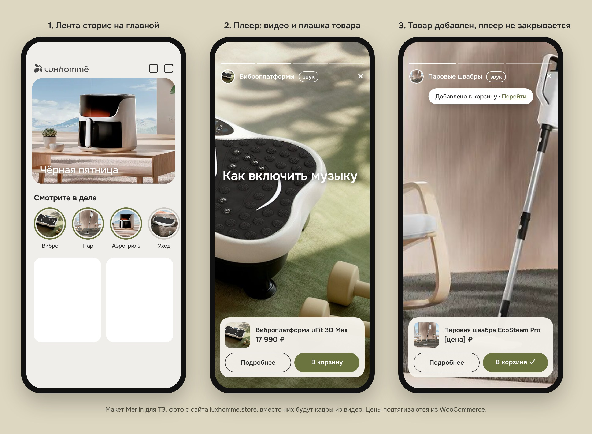
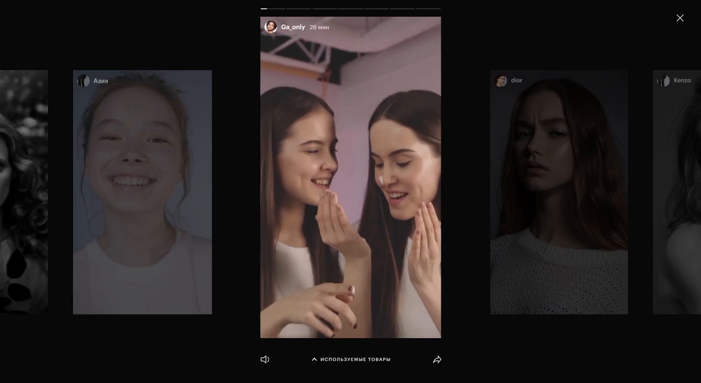
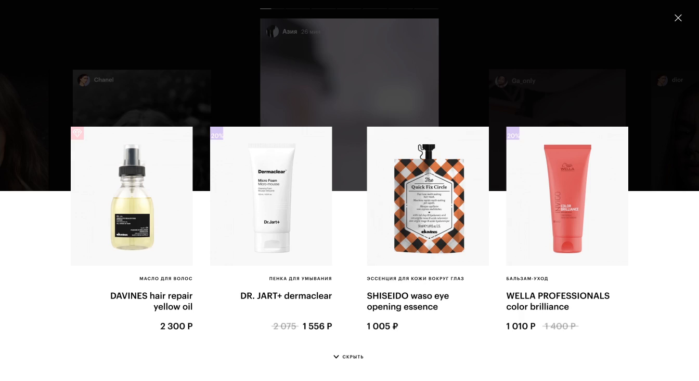

# ТЗ: лента видео-сторис на сайте luxhomme.store

Версия от 20.11.2026. Исполнитель: разработчик сайта (витрина Next.js + WordPress/WooCommerce).

## 1. Цель

Короткие вертикальные видео о товарах в формате сторис. Из видео покупатель в один клик переходит в карточку товара или кладёт товар в корзину.

Что даёт:

- показывает товар в работе (пар, уборка шерсти, капучино, виброплатформа);
- ведёт трафик в карточки с главной и из каталога;
- даёт новый контент для видео, которые уже снимаются для Ozon и соцсетей.

### Как это будет выглядеть на luxhomme.store

{width=17cm}

## 2. Где показываем

| Страница | Что выводим |
|---|---|
| Главная | Лента всех активных сторис, сразу под первым экраном (баннером) |
| Категория каталога | Сторис товаров этой категории (если их нет, ленту не показываем) |
| Карточка товара | Сторис этого товара, под галереей фото (если их нет, ленту не показываем) |

## 3. Как выглядит лента

- Горизонтальный ряд круглых или скруглённых превью с подписью под ними (1–2 слова, до 14 символов: «Пар», «Шерсть», «Капучино»).
- Размер превью: 72–80 px на телефоне, 96–110 px на компьютере.
- Обводка у непросмотренных сторис в фирменном оливковом #6B743F, у просмотренных серая #C9C7C0. Отметку о просмотре храним в localStorage, без авторизации.
- На телефоне ленту листают пальцем, на компьютере стрелками по краям. Если сторис больше, чем помещается в экран, последнее превью видно наполовину: так понятно, что лента листается.
- Шрифт и цвета как на сайте: Onest, фон #EFEEEB, текст #2A2A2A.

## 4. Плеер (по клику на превью)

### Телефон
- Полноэкранный вертикальный плеер 9:16.
- Сверху полоски прогресса по числу роликов в группе, ниже логотип или название группы и крестик «Закрыть».
- Касание правой трети экрана: следующий ролик, левой трети: предыдущий. Удержание пальца: пауза. Свайп вниз: закрыть. Свайп влево или вправо: соседняя группа.
- После последнего ролика группы автоматически открывается следующая группа, после последней группы плеер закрывается.

### Компьютер
- Модальное окно по центру экрана, плеер 9:16 высотой около 85% окна, фон затемнён.
- По бокам стрелки и превью соседних групп. Работают клавиши ← → (переключение), пробел (пауза), Esc (закрыть).

### Общее
- Видео стартует без звука (так требуют браузеры для автозапуска). Кнопка звука в правом верхнем углу, выбор запоминается до конца визита.
- Пока видео грузится, показываем обложку (постер) и индикатор загрузки.
- При открытии плеера адрес меняется на `?story=<id>`, кнопка «Назад» в браузере закрывает плеер. По такой ссылке сторис открывается сразу: ей можно делиться.
- При закрытии скролл страницы остаётся на месте.

## 5. Переход к товару (главное)

- Внизу каждого ролика плашка товара: фото 56×56, название, цена (и старая цена, если есть скидка), кнопка «Подробнее».
- Если к ролику привязано несколько товаров (до 3), плашки листаются горизонтально.
- Клик по плашке или по «Подробнее»: переход в карточку товара в той же вкладке. Плеер закрывается, к ссылке добавляются метки `utm_source=site&utm_medium=stories&utm_campaign=<id сторис>`.
- Вторая кнопка «В корзину», если товар в наличии и у него нет вариантов. Товар добавляется без ухода из плеера, сверху всплывает «Добавлено в корзину» и ссылка «Перейти в корзину». Если товара нет в наличии, вместо кнопки надпись «Нет в наличии» и только переход в карточку.
- Цена и наличие берутся из WooCommerce в момент показа, а не вписываются руками в сторис.

## 6. Админка (WordPress)

Отдельный тип записи «Сторис» в меню WordPress:

| Поле | Что заполняет контент-менеджер |
|---|---|
| Группа | Название группы и превью для ленты (например, «EcoSteam Pro»). Одна группа = один кружок в ленте, внутри 1–10 роликов |
| Видео | Загрузка файла MP4 |
| Обложка | Картинка, если не задана: первый кадр видео |
| Товары | Выбор 1–3 товаров из WooCommerce (поиск по названию или артикулу) |
| Текст кнопки | По умолчанию «Подробнее» |
| Где показывать | Главная / категории товаров / карточки товаров (галочки) |
| Порядок | Число для сортировки |
| Даты показа | С и по (для акций: Чёрная пятница, День матери), можно оставить пустыми |
| Статус | Включено / выключено |

Сторис в карточке и категории подтягиваются автоматически по привязанным товарам: вручную назначать не нужно.

## 7. Требования к видео

- Формат MP4 (H.264, AAC), вертикальный 9:16, 1080×1920.
- Длительность одного ролика 5–30 секунд.
- Вес до 8 МБ. Сервер при загрузке делает облегчённую версию 720×1280 для мобильных; если это сложно, сжатие делаем до загрузки, и в админке выводим подсказку о лимите.
- Безопасные зоны: важный текст на видео не ближе 250 px к верху и 400 px к низу (там прогресс-бар и плашка товара).
- Субтитры желательно вшивать в видео: большинство смотрит без звука.

## 8. Производительность и техника

- Лента и плеер не должны ухудшать загрузку страницы: превью грузятся лениво, видео запрашивается только при открытии плеера. Заранее подгружаем только следующий ролик.
- Видео отдаём с CDN или с отдельного домена со статикой, с поддержкой Range-запросов (перемотка без загрузки всего файла).
- Данные для ленты отдаёт REST-эндпоинт WordPress (например, `/wp-json/luxhomme/v1/stories?place=home|category&id=…`), витрина Next.js кэширует ответ на 5–10 минут.
- Поддержка: последние 2 версии Chrome, Safari (в том числе iOS), Яндекс Браузера, Firefox. На iOS видео играет внутри страницы (`playsinline`), без перехода в системный плеер.
- Доступность: у кнопок есть подписи для экранных дикторов, плеер управляется с клавиатуры, фокус возвращается на превью после закрытия.
- SEO: лента не должна создавать новые адреса страниц для индексации. Параметр `?story=` закрыт через Clean-param в robots.txt.

## 9. Аналитика (Яндекс Метрика)

Цели (JavaScript-события):

| Событие | Когда |
|---|---|
| `stories_open` | Открыли плеер (параметры: id группы, страница) |
| `stories_view_complete` | Ролик досмотрен до конца |
| `stories_product_click` | Клик по плашке товара (параметр: артикул) |
| `stories_add_to_cart` | Товар добавлен в корзину из плеера |

Плюс метки utm на переходах в карточку (раздел 5): так заказы из сторис видны в отчётах.

## 10. Что принимаем (критерии приёмки)

1. Лента видна на главной, в категории и в карточке, если для них есть активные сторис; если нет, блока нет и пустого места тоже.
2. На телефоне работают касания, удержание, свайпы; на компьютере стрелки, клавиши и Esc.
3. Клик по плашке товара открывает правильную карточку с utm-метками; «В корзину» добавляет товар без ухода из плеера.
4. Цена и наличие на плашке совпадают с карточкой товара.
5. Сторис с истёкшей датой показа или выключенные не показываются.
6. Скорость: оценка PageSpeed для главной на мобильном не падает больше чем на 3 пункта после внедрения.
7. Все 4 цели Метрики срабатывают (проверка в отладке Метрики).
8. Ссылка с `?story=` открывает нужную сторис; «Назад» закрывает плеер.

## 11. Готовый сервис или своя разработка

| Вариант | Плюсы | Минусы |
|---|---|---|
| Своя разработка по этому ТЗ | Полный контроль дизайна, цены и наличие из WooCommerce, нет абонентской платы | Время разработчика |
| Готовый виджет (например, «Сторси») | Быстрый запуск, есть разметка товаров в видео | Абонентская плата, сторонний скрипт на сайте, связь с каталогом WooCommerce нужно проверять |

Рекомендация: своя разработка, потому что витрина на Next.js и каталог в WooCommerce уже есть. Готовый виджет имеет смысл только для быстрого теста до разработки.

## 12. Примеры

«Золотое Яблоко»: сторис на сайте (кадры из демо-видео в кейсе агентства ONY, https://ony.ru/work/goldapple).

{width=16cm}

{width=16cm}

{width=16cm}

Другие сервисы и материалы:

- «Сторси» (российский сервис): вертикальные видео на страницах каталога и в карточках; товары отмечаются в видео, в плеере всплывает карточка с кнопкой «Купить» или «В корзину». https://onbd.ru/blog/storsy-ecommerce-stories
- Tolstoy: формат сторис (как в Instagram) и ленты (как в TikTok) с товарами в видео; примеры магазинов по отраслям. https://www.gotolstoy.com/blog/what-is-a-shoppable-video-with-examples и https://www.gotolstoy.com/post/the-best-shoppable-video-examples-through-different-industries
- Videowise: настройка виджета сторис на сайте, форматы (сторис, карусель, видео в карточке). https://help.videowise.com/video-widgets/6vD2MbeBhPyh8aCK9uZcEf/how-to-create-a-stories-widget/6xqT6tdk4S8sZuMkSMp4KH
- Spectrum: форматы виджетов (кружки сторис, лента-карусель, сетка, видео в карточке, плавающий кружок). https://getspectrum.ai/apps/shoppable-videos
- Frisbuy: сторис на сайте со ссылками на товары. https://www.retail.ru/rbc/pressreleases/frisbuy-ru-stories-iz-instagram-na-sayte-i-v-prilozhenii-zachem-kak-i-primery/

## 13. Контент на старт (от Merlin и Luxhommè)

6 групп по 2–4 ролика: виброплатформы uFit, паровые швабры, аэрогрили, кофемашины, пылесосы, акция месяца. Источник: видео для медийки Ozon и соцсетей, перемонтированные в 9:16 с плашками в безопасных зонах.

Внедрение на сайт только после согласования с клиентом.
